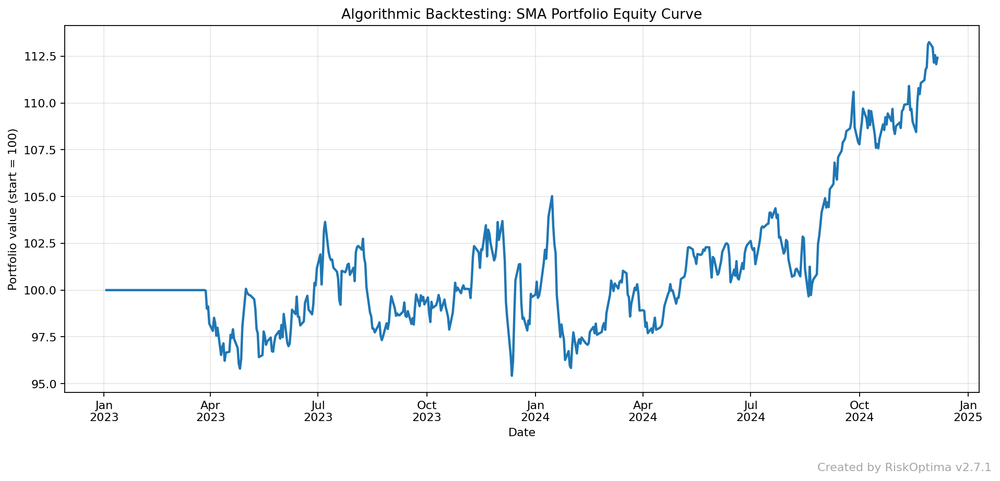
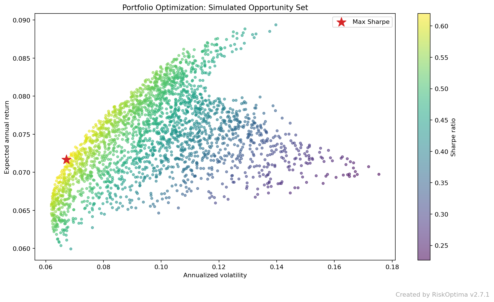
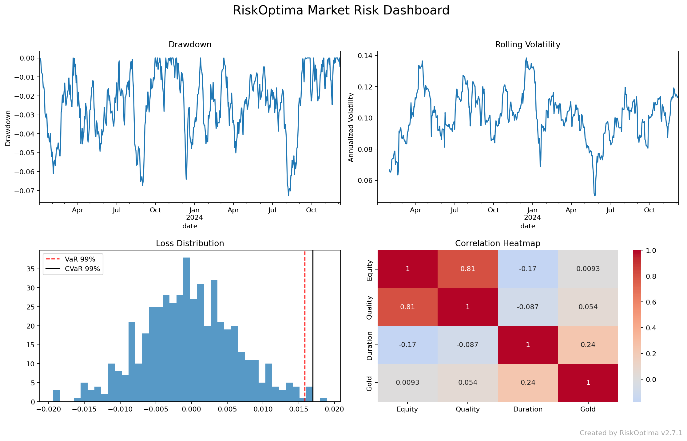
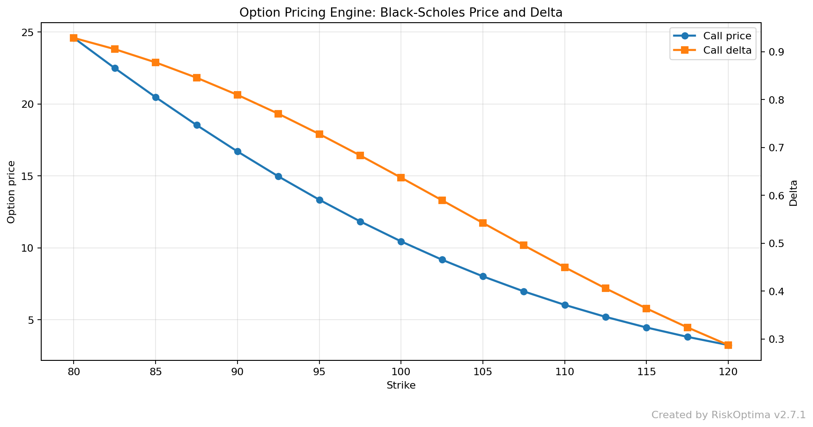
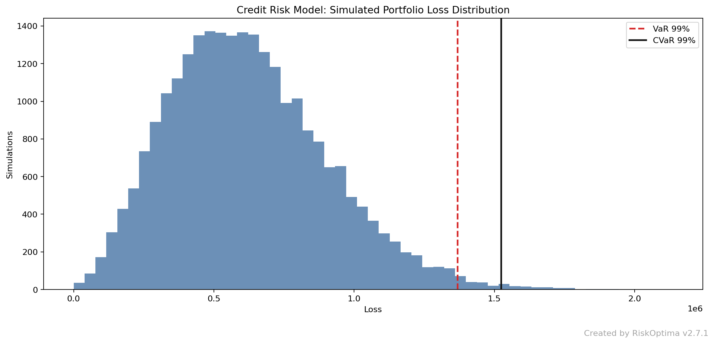

# Quant Project Map

This page maps RiskOptima to the five canonical projects commonly expected in a quant developer portfolio.

## 1. Algorithmic Trading Backtester

RiskOptima includes a modular backtesting engine with strategy interfaces, portfolio state tracking, transaction cost estimation, and weight history output.

The SMA crossover helper is intentionally simple and explainable: a short moving average above a long moving average represents positive trend momentum, while a bearish cross or risk rule exits the position. This gives users a transparent baseline strategy before they move into more complex signals.

The event backtest gives strategies prices strictly before execution. The SMA
trade-log helpers keep same-close execution as the compatibility default.
Use `execution="next_close"` when entries, exits, stops or take profits use
the completed close to make a decision. The pending order fills at the next
available close. Missing closes cannot trigger or fill orders, and the trade
log contains closed trades. Stops and targets use observed closes. Modeling
intraday threshold fills requires intraday prices and an execution policy.

The Yahoo Finance SMA adapter labels its output with its source, symbol,
Close field, adjustment setting and session-date index role. Signal frames
and single-asset trade logs carry these tags along with the signal or
execution timing. Session dates alone do not establish historical data
availability or protect against vendor revisions.

Core files:

- `riskoptima/backtest/engine.py`
- `riskoptima/backtest/strategy.py`
- `riskoptima/backtest/portfolio.py`
- `riskoptima/backtest/sma.py`
- `tests/test_backtest_engine.py`
- `tests/test_sma_backtest.py`

## 2. Portfolio Optimization

The optimizer layer supports max-Sharpe and minimum-variance portfolios with bounds and factor exposure constraints. The reporting layer also includes a portfolio sophistication report that compares MV, CVaR, EVaR, RLVaR, WR, CDaR, EDaR, RLDaR, MDD, and 1/N allocations with cumulative wealth curves and a tear-sheet style metrics table.

Core files:

- `riskoptima/optim/mean_variance.py`
- `riskoptima/optim/constraints.py`
- `riskoptima/reporting/sophistication.py`
- `tests/test_optimizer_constraints.py`
- `tests/test_portfolio_sophistication_report.py`
- `02-portfolio_optimization_riskoptima.ipynb`
- `09-portfolio_sophistication_report_demo.ipynb`

## 3. Market Risk Dashboard

The reporting layer builds a dashboard-ready `RiskReport` with volatility, Sharpe, Sortino, drawdown, historical VaR, Gaussian VaR, CVaR, beta, tracking error, information ratio, rolling volatility, and rolling drawdown. It also includes a Gaussian Hidden Markov Model report for latent bull, bear, and sideways market regime detection. The volatility toolkit adds historical, realized, EWMA, OHLC, and implied volatility estimators.

Fit the HMM on training observations and call `model.filter_probabilities(validation_returns)` with later data. The filter advances the terminal training posterior under fixed parameters. Pass `continue_from_fit=False` for an independent sequence starting from the fitted initial distribution. Each call leaves the fitted model untouched. Dated continuations must start after the training cutoff. Each finite observation advances the state once.

Core files:

- `riskoptima/reporting/market_risk.py`
- `riskoptima/reporting/markov_regimes.py`
- `riskoptima/risk/markov_regime.py`
- `riskoptima/volatility/estimators.py`
- `riskoptima/volatility/ohlc.py`
- `examples/example_market_risk_dashboard.py`
- `examples/streamlit_market_risk_dashboard.py`
- `tests/test_market_risk_report.py`
- `tests/test_markov_regime_report.py`
- `tests/test_volatility_toolkit.py`
- `10-markov_regime_model_demo.ipynb`
- `11-portfolio_markov_regime_demo.ipynb`
- `12-volatility_toolkit_demo.ipynb`

## 4. Option Pricing Engine

The options package exposes Black-Scholes pricing, Greeks, implied volatility, binomial trees, and Monte Carlo European option pricing.

Core files:

- `riskoptima/options/black_scholes.py`
- `riskoptima/options/greeks.py`
- `riskoptima/options/implied_vol.py`
- `riskoptima/options/binomial.py`
- `riskoptima/options/monte_carlo.py`
- `tests/test_options_engine.py`

## 5. Credit Risk Model

The credit package covers PD/LGD/EAD expected loss, unexpected loss, transition matrices, rating migration, Merton structural default probability, Credit VaR, and Credit CVaR.

Core files:

- `riskoptima/credit/models.py`
- `riskoptima/credit/metrics.py`
- `riskoptima/credit/portfolio.py`
- `riskoptima/credit/simulation.py`
- `08-credit_risk_model_demo.ipynb`
- `tests/test_credit_risk.py`
